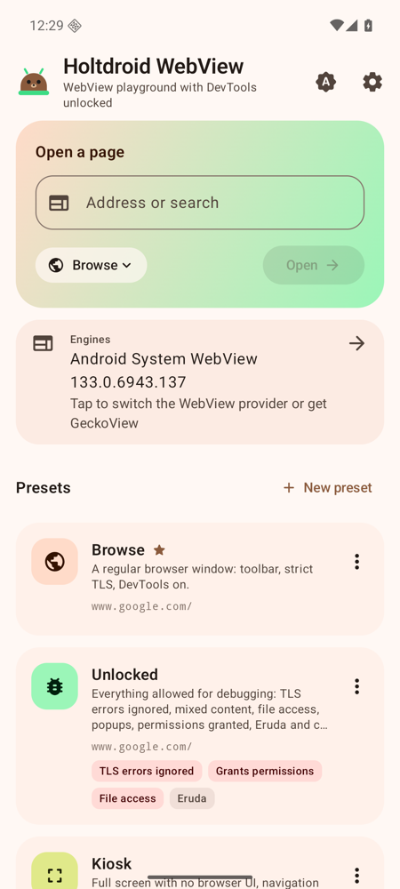
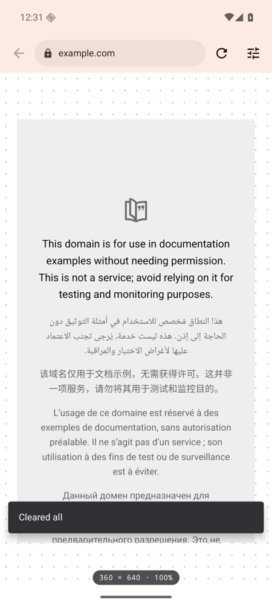
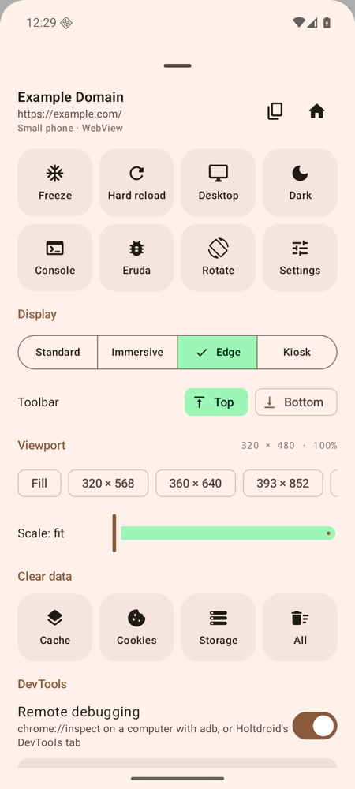
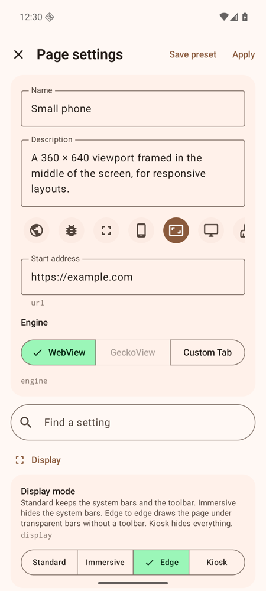

<p align="center"></p>

<h1 align="center">Holtdroid WebView</h1>

<p align="center">An Android WebView playground with DevTools unlocked, presets and adb control.</p>

Holtdroid WebView is the test browser of [Holtdroid](https://github.com/holtdroid/holtdroid),
the self-hosted portal for Android test devices, but it doesn't need Holtdroid: install the APK
on any device or emulator and use it on its own.

It opens a page in the system WebView (or GeckoView) and lets you change how that WebView is set
up: full screen or with a toolbar, a fixed viewport size, strict or relaxed TLS, locked or
unlocked features, a user agent, a proxy, user scripts. Remote debugging is on by default, so
every page shows up in `chrome://inspect` and in Holtdroid's DevTools tab.

<p align="center">
  
  
  
  
</p>

## Features

- **Presets** on the start screen: Browse, Unlocked, Kiosk, App shell, Small phone, Desktop
  site, Fresh start and Proxy ship with the app; make your own, duplicate, reorder, pick a default.
- **Display modes**: standard (toolbar and system bars), immersive, edge to edge (the page under
  transparent bars, to test safe-area insets) and kiosk; toolbar on top or at the bottom; a
  floating handle for the controls when the toolbar is hidden; orientation lock; keep screen on.
- **Viewport**: frame the page at any size in CSS pixels, rotate it, scale it; freeze the page
  (timers, animations and rendering stop) and resume it.
- **WebView settings**: JavaScript, DOM storage, zoom, wide viewport, overview mode, text zoom,
  algorithmic darkening, autoplay, offline mode, image blocking, HTTP cache mode.
- **Security**: TLS errors strict / ask / ignore, mixed content, Safe Browsing, cookies and
  third-party cookies, site permissions ask / grant / deny, a host allowlist, popups, JavaScript
  dialogs, long press, file and content access, data wiped on start.
- **Identity and network**: desktop or custom user agent, a suffix, extra request headers, a proxy
  with a bypass list, user CA certificates trusted for mitmproxy and Charles.
- **DevTools**: remote debugging, an in-app console with a JavaScript prompt, Eruda bundled
  into the APK (works offline and under a strict CSP), a user script injected at document start.
- **On-screen keyboard button** for emulators with a hardware keyboard, where Android hides the
  on-screen one; it can switch `show_ime_with_hard_keyboard` on when granted
  `WRITE_SECURE_SETTINGS`.
- **Engines**: the system WebView (with the installed providers and the adb command that switches
  between them), GeckoView in the `-gecko` build, and Custom Tabs.
- **Clear data**: cache, cookies, storage, history or everything, from the panel or adb.
- **adb control**: every setting has a key; `am start` opens pages with overrides and
  `am broadcast` changes the open page live and answers with the result.
- Light, dark and system themes, Material You colours if you want them.

## Install

Download an APK from [Releases](https://github.com/holtdroid/holtdroid-webview/releases):

| File | What |
|------|------|
| `holtdroid-webview-<version>.apk` | WebView and Custom Tabs, about 2 MB, any ABI |
| `holtdroid-webview-gecko-<version>.apk` | the same plus GeckoView for `arm64-v8a`, `armeabi-v7a` and `x86_64`, about 240 MB |

They are two separate apps, Holtdroid WebView (`io.github.holtdroid.webview`) and
Holtdroid WebView Gecko (`io.github.holtdroid.webview.gecko`), and can be installed
side by side.

```sh
adb install -r holtdroid-webview-0.1.0.apk
```

## Drive it from adb

```sh
P=io.github.holtdroid.webview   # or io.github.holtdroid.webview.gecko
A=io.github.holtdroid.webview

# open a page with a preset and overrides
adb shell am start -n $P/$A.MainActivity --es preset unlocked --es url https://example.com --es display kiosk

# change the open page live
adb shell am broadcast -a $A.CONTROL -p $P --es cmd resize --es size 360x640
adb shell am broadcast -a $A.CONTROL -p $P --es cmd freeze
adb shell am broadcast -a $A.CONTROL -p $P --es cmd clear --es what cookies
adb shell am broadcast -a $A.CONTROL -p $P --es cmd state
```

All commands and setting keys are in the
[documentation](https://holtdroid.github.io/holtdroid/tools/webview/).

## Build

The toolchain is JDK 21 (pinned in `mise.toml`) and the Android SDK with platform 37.2.

```sh
./gradlew testWebviewDebugUnitTest lintWebviewDebug lintGeckoDebug
./gradlew assembleWebviewDebug                     # app/build/outputs/apk/webview/debug
./gradlew assembleGeckoDebug -PgeckoAbi=x86_64     # GeckoView for one ABI (all three by default)
./gradlew assembleWebviewRelease -PappVersion=1.2.3
```

The build downloads [Eruda](https://github.com/liriliri/eruda) from npm (version in
`app/build.gradle.kts`, kept fresh by Renovate) and packs it into the APK's assets.

Release builds are signed when `SIGNING_KEYSTORE`, `SIGNING_STORE_PASSWORD`,
`SIGNING_KEY_ALIAS` and `SIGNING_KEY_PASSWORD` are set, and with the debug key otherwise.

## Releases

Every push to `main` runs `.github/workflows/release.yml`. It reads the
[Conventional Commits](https://www.conventionalcommits.org) since the last tag: `feat` makes a
minor release, `fix` and `perf` a patch, a breaking change a major one; other types release
nothing. The workflow builds and signs the APKs, tags `vX.Y.Z` and publishes a GitHub release
with the changelog.

[Renovate](https://docs.renovatebot.com) keeps dependencies fresh (`renovate.json`): library
updates land as `fix(deps)` commits, so a merged update ships as a patch release on its own.
Minor and patch updates and GeckoView releases merge automatically once CI is green; other
major updates wait for review.

## License

Apache-2.0
